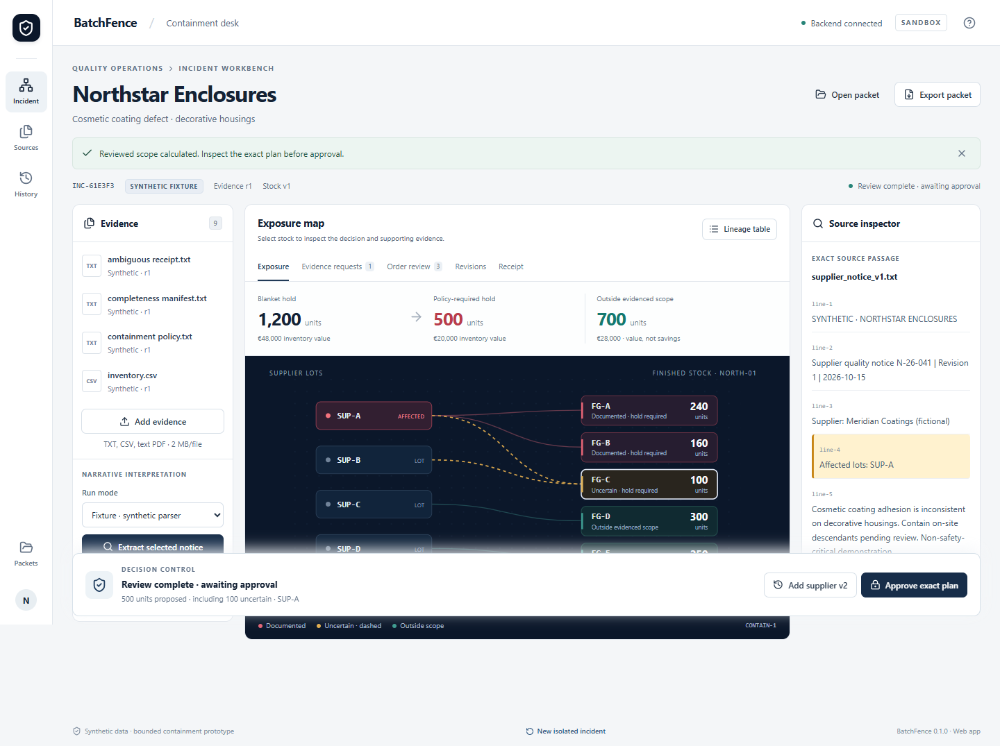

# BatchFence

Evidence-backed lot containment for a small manufacturer's quality manager. A supplier notice becomes a reviewed scope, a deterministic hold plan and a real **sandbox** receipt. Changed evidence invalidates approval.

**Working web and installed Windows 0.1.1 prototype, with genuine local AMD-driven synthetic workflows and ambiguity containment. Free public demo is deployed. A live AMD response drove a reviewed 500-unit receipt; the revised 800-unit live request was rejected for invalid citations.** Raw model errors and agent-operated review are disclosed; no independent human validation or savings are claimed.

Repository: [NuraliKuzhagaliev/BatchFence](https://github.com/NuraliKuzhagaliev/BatchFence).

Public app: **https://batchfence.onrender.com**. See [deployment status, cost and verification gates](DEPLOYMENT.md). The free Render service serves FastAPI + React from one HTTPS origin. Its SQLite storage is temporary: export packets before sleep, restart or redeployment. Durable cloud persistence is not provided. Public Synthetic and historical AMD Replay are separated from protected Live inference.

## Open

Project: D:\projects\BatchFence.

    cd D:\projects\BatchFence
    .\.venv\Scripts\python.exe -m uvicorn backend.app:app --host 127.0.0.1 --port 8787

Open **http://127.0.0.1:8787**. Health: /api/health. API schema: /openapi.json.

Windows installer: releases/BatchFence-0.1.1-win-x64-setup.exe. Version 0.1.1, Windows 11 x64, **unsigned**. See [desktop release](docs/desktop_release.md) and releases/SHA256SUMS-0.1.1.txt. Installed verification executable: work/installed-0.1.1/BatchFence.exe.

The desktop uses the local backend at 127.0.0.1:8787. Its installed renderer opens saved packets offline without external Node/Python. New analysis/actions need the backend. The public web demo is available; no installer download has been published. This local installer is not advertised as a cloud release for another person's machine.

## Walkthrough

1. Load the labeled synthetic incident and select its supplier notice.
2. Select Fixture mode for a deterministic rehearsal, or Live for a real AMD request. All candidates start unresolved. Review affected/unresolved/excluded groups; narrowing needs an explicit complete incident boundary, exact source quote and explanation.
3. Inspect 500 held units: 400 documented and 100 uncertain. Open requests and order review.
4. Approve. Test excluding uncertain stock to see server policy rejection.
5. Add supplier v2 and test stale approval. Extract/review the revised notice.
6. The new scope produces 800 held units and four open orders needing review. Approve/apply.
7. Export the packet with its genuine sandbox receipt. Open on desktop for offline read-only review.

The blanket comparison is 1,200 units /€48,000. Under v1,€28,000 of carrying value is outside the proposed broad hold. This is not measured cash savings.

## Setup

Tested with Windows 11 build 26200, Node 22.20.0 and Python 3.13.2. Lockfiles pin installed dependencies. Source, cache, virtual environment and release files reside on D:.

    npm ci --cache .cache/npm
    python -m venv .venv
    .\.venv\Scripts\python.exe -m pip install --cache-dir .cache/pip -r requirements.txt
    npm run build

Run the server above. Optional scripts/setup.ps1 and scripts/start.ps1 work when allowed by existing shell policy. No policy change is required. npm run dev starts Vite with a proxy to the same backend.

## AMD

Copy .env.example to a private .env; its empty placeholders contain no provider credentials or assumed endpoint. See DEPLOYMENT.md for public configuration. From authenticated AMD documentation, set AMD_API_BASE_URL, AMD_API_KEY, AMD_MODEL_ID and AMD_PROVIDER_EVIDENCE. Confirm AMD_API_STYLE=openai-chat only if documented. Set INFERENCE_MODE=live. Enable AMD_JSON_SCHEMA only after support is verified.

    .\.venv\Scripts\python.exe -m scripts.probe_amd

This makes four bounded synthetic probes once configured. Inspect semantics/citations, then run a fresh notice and a changed notice through the application. Credentials stay server-side. Never use VITE_ secrets or commit .env.

Current evidence: genuine MiMo responses drove 500/800-unit plans and receipts. Ambiguous scope now yields a 1,200-unit hold; a separate invalid citation blocks review. Gemma failures and raw MiMo errors remain recorded. See [AMD evidence](docs/amd_evidence.md), [ambiguity audit](docs/ambiguity-fix/README.md) and [handoff](HANDOFF.md). Current submission assets have explicit 0.1.1 filenames.

## Inputs

UTF-8 TXT, strict CSV and selectable-text PDF: 2 MB/file, 24 documents/case, 80,000 normalized characters/document. Image-only PDFs receive an unsupported result. CSV headers are in fixtures/demo. Dataset replacements remain pending until review, reconcile quantities and preserve existing holds.

Native choose/save/open exposes bounded file bytes. Actual Windows dialogs passed on the prior 0.1.0 checkpoint. Current 0.1.1 automated checks use dialog stubs; recheck real dialogs on the exact release before distribution.

Packets preserve historical evidence, reviews and receipts without session authority. Hashes detect changes and do not authenticate suppliers. Offline packets cannot infer/approve/apply/queue writes. Reconnection reloads current state. Promotion creates a new draft.

## Verify

    npm run build
    .\.venv\Scripts\python.exe -m pytest -q --basetemp work/pytest-verify
    .\.venv\Scripts\python.exe -m scripts.evaluate
    node scripts/browser-smoke.cjs
    node scripts/desktop-smoke.cjs
    node scripts/desktop-offline.cjs

Start the server first. Browser tests use installed Microsoft Edge. Desktop tests use the real installer installed under work/installed-0.1.1 (set BATCHFENCE_TEST_EXE), with stubbed dialogs for repeatability.

Current local publication checks: 48 pytest checks and 30/30 frozen domain cases (18 development, 12 held out), real web/installed workflows and offline review without external Node/Python on child PATH. Exact results are in docs/*results.json. [Evaluation](docs/evaluation.md) separates these from unmeasured model performance.

Windows packaging:

    $env:ELECTRON_CACHE='D:\projects\BatchFence\.cache\electron'
    $env:ELECTRON_BUILDER_CACHE='D:\projects\BatchFence\.cache\electron-builder'
    npm run package:desktop

The build is unsigned. Do not disable OS protections. Signing/distribution require authorized configuration.

## Materials

[Architecture](docs/architecture.md), [acceptance](docs/feature_acceptance.md), [visual review](docs/visual_review.md), [AMD evidence](docs/amd_evidence.md), [limitations](docs/limitations.md), [deployment](DEPLOYMENT.md), [provenance](docs/data_provenance.md).

Submission drafts, a six-slide PowerPoint, actual cover screenshot and recording guide are under submission/. Source is published on GitHub; hosting awaits cost approval and cloud checks. Video upload and final event submission have not occurred. Confirm the authenticated deadline and form.

Original code: MIT. Dependencies retain their licenses. See [notices](docs/third_party_notices.md). No model weights are redistributed.

Media: submission/BatchFence-demo.mp4 is a silent113.73-second real application recording with selectable captions, under2MB. Source and native-dialog limitations are disclosed in the captions. The1920Г—1080 cover is an actual screen capture. Set a public BATCHFENCE_BACKEND_ORIGIN before packaging an authorized remote desktop release; AMD credentials are never baked.
