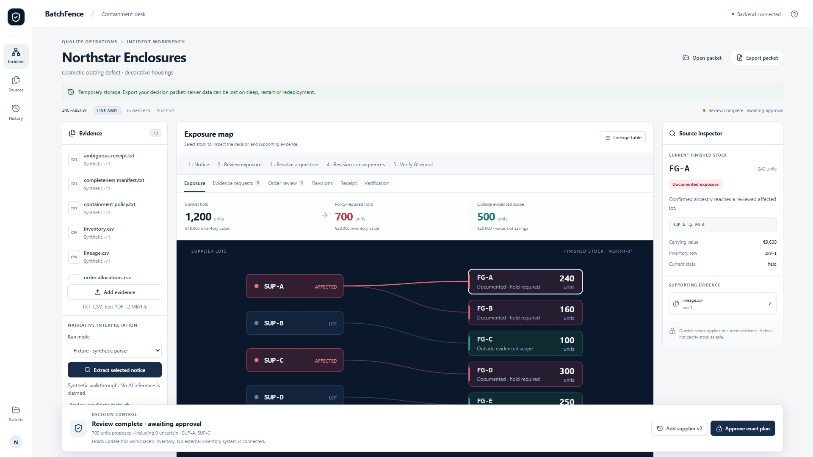

# BatchFence

Determine what to contain, what evidence to request next, and why a supplier revision changes the decision. Built for a small manufacturer's quality manager, demonstrated with fictional decorative-housing records.

[Web app](https://batchfence.onrender.com) · [Windows releases](https://github.com/NuraliKuzhagaliev/BatchFence/releases) · [Release evidence](docs/enterprise/release-0.3.0.md) · [Claims and checks](docs/claims-to-evidence.md)

0.3.0 connects Quality Signals, Approved Knowledge, Controlled Recovery and Corrective Action with Effectiveness. PostgreSQL pilot storage, named scoped identities, source-preserving OCR, mapped intake and typed receiving support the same incident. Deterministic containment, explicit review, stale rejection, receipts and offline packets remain. [Fresh AMD results and retained errors](docs/enterprise/live/README.md) distinguish model quality from reviewed outcomes.



## One incident, three decisions

1. Open example incident, select Synthetic for a rehearsal or protected Live AMD for fresh interpretation. Historical AMD Replay is a separate read-only path.
2. Review each lot's source and disposition; candidates start unresolved. A narrowed boundary requires an exact quote and explicit review. The frozen v1 example proposes 500 units (400 documented + 100 uncertain), compared with a 1,200-unit blanket hold.
3. Open Evidence requests. FG-C has possible SUP-A/SUP-B ancestry. A complete SUP-B-only receiving record could change 500→400; this is a conditional simulation, not a release. Shared boundary gaps are distinguished from missing receiving records.
4. Approve, add supplier v2, and test the old approval: it is rejected. Review v2; the proposal expands to 800, through SUP-C → FG-D (300 units) → O-104. Use Revisions to inspect both immutable plans.
5. From the receiving question, attach a reply and interpret it. Inspect raw proposals, choose the reviewed identity, preview the effect and explicitly confirm the replacement. An inconclusive reply cannot narrow. A complete answer can propose 700 while all 800 already-held units remain held.
6. Run isolated synthetic boundary challenges, export the receipt packet, and reopen it on web or Windows without approval authority.

## Run locally

```
cd D:\projects\BatchFence
npm ci --cache .cache/npm
python -m venv .venv
.venv\Scripts\python.exe -m pip install --cache-dir .cache/pip -r requirements.txt
npm run build
.venv\Scripts\python.exe -m uvicorn backend.app:app --host 127.0.0.1 --port 8787
```

Open http://127.0.0.1:8787. Copy .env.example to private .env and configure actual AMD provider values for Live. No provider credentials are required for Synthetic or historical replay. Hosted Live uses the separate LIVE_DEMO_TOKEN access key; never paste AMD_API_KEY into the frontend.

Windows x64 installers are **unsigned**. The current hosted-client package uses https://batchfence.onrender.com; BATCHFENCE_BACKEND_ORIGIN can select the existing local backend. No Python installation is needed for the hosted client. Saved packets open offline; new inference and actions require a backend. Download verified versioned assets and SHA256SUMS from Releases; do not replace a published binary under the same version.

## Evidence and limits

Verified upgrade: 65 pytest, 30 unchanged frozen domain cases, 12 existing and nine new browser groups on the public app, nine installed upgrade groups locally, and seven installed checks against the public backend. Four fresh AMD requests drove reviewed 500/800 receipts and a receiving clarification. The first reply omitted SUP-B and narrowing was rejected; a clearer reply supported a 700-unit proposal while all 800 applied units remained held. Raw model errors and explicit agent reviews are separate. No independent human validation.

Source interpretation is fallible; raw output and corrections remain inspectable. Exact citations do not prove supplier truth. Complete receiving replacement currently accepts the explicit record syntax documented in DEPLOYMENT.md; other prose needs clarification. Simulations cannot approve or execute. Inventory carrying value is not cash savings; overlaps are counted once.

Free Render SQLite is temporary and can lose receipts on restart/redeploy: export packets. Holds update workspace inventory only; no ERP, machinery or supplier messaging integration is connected. Physical OS dialog acceptance and independent domain validation remain separate release limitations. No paid resources or optional extra-model integrations are added.

[Deployment and security](DEPLOYMENT.md) · [Morning handoff](HANDOFF.md) · [AMD evidence and limitations](docs/amd_evidence.md) · [Upgrade plan](UPGRADE_PLAN.md)

Current media: [walkthrough](submission/BatchFence-demo-0.2.0.mp4), [six-slide pitch](submission/BatchFence-pitch-0.2.0.pptx), [provenance and submission notes](submission/README.md). Synthetic rehearsal and historical AMD replay are explicitly labeled.
