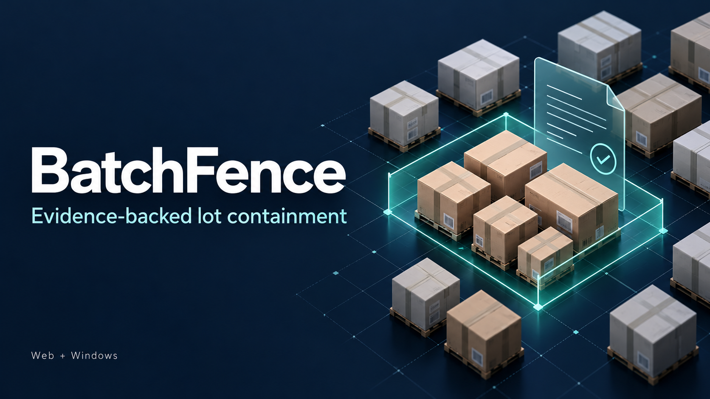
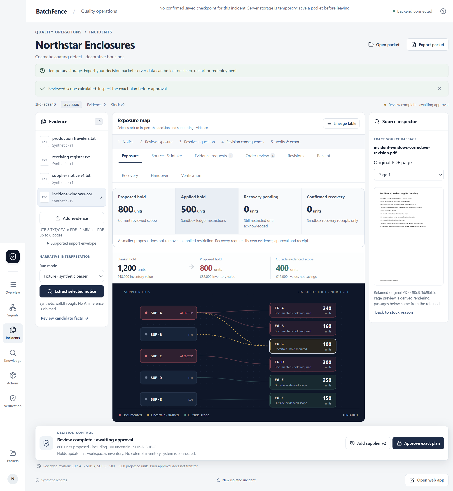

# BatchFence

Evidence-backed lot containment for quality teams: turn supplier notices into reviewed facts, calculate a conservative hold, and keep every approval and sandbox receipt tied to its evidence.

[Open web app](https://batchfence.onrender.com/) · [Download Windows x64](https://github.com/NuraliKuzhagaliev/BatchFence/releases/download/v0.4.0-rc.6/BatchFence-0.4.0-rc.6-win-x64-setup.exe) · [Release and checksums](https://github.com/NuraliKuzhagaliev/BatchFence/releases/tag/v0.4.0-rc.6) · [PowerPoint](presentations/BatchFence_Deck.pptx) · [PDF presentation](presentations/BatchFence_Project_Deck_Preview.pdf)



*Illustrative project cover; actual application evidence appears below.*

**Public web: 0.4.0-rc.7**, with verified anonymous document analysis at runtime [`becdb4b`](https://github.com/NuraliKuzhagaliev/BatchFence/commit/becdb4b3335a5ea334be7db463cb915c6a6bd7ef). **Windows/source release: 0.4.0-rc.6**, preserved at tag [`d6fa31f`](https://github.com/NuraliKuzhagaliev/BatchFence/commit/d6fa31f7d321b0e0c51dad5afcb577b6e31e8130). The new browser entry needs no private token or provider account. This is a review-controlled hackathon application; independent operational acceptance and production enterprise readiness remain outstanding.

## Upload your own document (public judging)

Click **Analyze your document**: start an isolated editable source-review session, upload a nonsensitive supplier/quality notice, confirm external processing and run genuine direct AMD Gemma analysis without an owner token or provider account. Supported: UTF-8 TXT and readable native-text PDF, 2 MB, at most 8 PDF pages, within the existing bounded source context. Original passages, raw model output, proposed dispositions and unresolved inventory context remain separate. No sample inventory, automatic release or enterprise action authority is added.

Four AI attempts per visitor session, source-only routes, shared throttling and fresh provider catalog/usage checks apply. Historical engineering reservations remain intact and do not gate this route. The currently verified shared endpoint is free with an upstream daily cap. No event-access end date is published; the daily reset is not an access expiry, and availability can be withdrawn. See the [judge guide and actual acceptance status](docs/judge-access/README.md). Existing protected workspace routes still require their private access token.

## The incident workflow

BatchFence is demonstrated with fictional manufacturing records. It separates model proposals, reviewed facts, proposed quantities and applied holds.

1. **Intake evidence.** Import supplier notices and supported PDFs, or open the built-in example. Retain originals, source identities and immutable raw inference results.
2. **Review proposals.** Check lot identities, exact source passages, exclusions and completeness against the original. Missing or conflicting ancestry remains uncertain; unresolved incident scope requires explicit review before a narrowed plan can be approved.
3. **Calculate scope.** Deterministic rules trace supplier lots through finished goods and allocations. The example first proposes **500 units: 400 documented + 100 uncertain**, compared with a 1,200-unit blanket hold.
4. **Approve the exact plan.** Approval binds to current facts, sources, policy and plan. A supplier revision invalidates the old approval; reviewed v2 expands the example to **800 units**.
5. **Apply in the sandbox.** Execution updates workspace inventory and creates an immutable receipt. Retries are idempotent. No real ERP or physical inventory action is connected.
6. **Resolve and hand over.** A receiving clarification may reduce the proposal to 700 while **800 remain held**. Releasing the difference requires a separate controlled-recovery decision. Export packets for read-only review on either client.

The latest fresh revised-PDF checks drove the 800-unit result after explicit agent-operated review. Their 500-unit starting states were fixtures; earlier genuine first-500 evidence is retained separately. Synthetic rehearsal, historical replay and fresh inference are distinct modes, never silent substitutes.



## Connected capabilities

Four modules extend the incident record without granting the model action authority:

| Module | Implemented behavior |
| --- | --- |
| Quality Signals | Trace computed observations to supporting records and open an incident for review. |
| Approved Knowledge | Consult versioned approved procedures with source checks and explicit abstention. |
| Controlled Recovery | Keep proposed reductions separate from applied holds; require policy checks and separate approval. |
| Corrective Action and Effectiveness | Link corrective work and effectiveness evidence to the incident. |

Six shared web/Windows extensions reuse those controls:

| Extension | Behavior and acceptance boundary |
| --- | --- |
| Next Useful Evidence | Rank conditional evidence requests, attach a response and review its effect; no supplier messages are sent. |
| Release Readiness | Evaluate clause-linked conditions; a readiness result does not release inventory. |
| Label Photo Verification | Fresh AMD image reading verified readable and mismatching/multiple synthetic labels on web and Windows. Original-image and relationship confirmation remain mandatory; physical-photo reliability is unverified. |
| Document Change Impact | Track version dependencies and require re-review when approved sources change; historical receipts remain intact. |
| Multilingual Evidence Review | Preserve originals and derived translations with identifier/ambiguity checks. Independent bilingual acceptance remains pending. Unicode lexical retrieval is not semantic translation. |
| Shift Handover | Build reviewable snapshots with staleness checks and read-only export; no automatic delivery. |

See the [extension coverage map](docs/continuation/scope-map.md) for the original rc1 acceptance scope, [vision follow-up](docs/vision-fix/RESULTS.md) for later live image checks, and [latest source/RAG results](docs/identity-rag-fix/RESULTS.md) for rc6. Older pending statements in historical records are superseded only by the corresponding later evidence.

## AMD and Evolus integration

- **Direct AMD:** separate configured MiMo and Gemma routes; direct Gemma vision uses genuine image input. Endpoints and model identifiers come from authorized provider documentation and private configuration.
- **Evolus:** authenticated PDF reader/extractor and configured Gemma agent feed source-backed proposals. The saved connection is configured as `own/gemma-4-31b-it`; Evolus does not expose the runtime model identifier, so it is reported as unknown.
- **Approved-source RAG:** model-selected document/version/passage keys resolve only after independently reading identified indexed chunks and checking the approved original, hash, version and owner. The complete original caveat is displayed. These are **application-verified indexed-source citations**; provider-native citation annotations remain empty.
- **Conservative assembly:** missing extracted or interpreted lot identities stay unresolved and invalidate complete scope. Raw failures are retained. The recurring document-metadata format error is contained without relaxing stock-identity validation or granting automatic review.

Fresh public-web and installed-Windows PDF/RAG workflows are retained in the [case-by-case report](docs/identity-rag-fix/case-by-case.json). [Raw model quality](docs/identity-rag-fix/raw-quality.json) is reported separately from safe downstream review. The [frozen Gemma/MiMo evaluation](docs/continuation/evaluation/README.md) is historical; differing configurations and a one-case difference do not establish model superiority.

**Historical protected-workspace evaluation gate (not the visitor route):** the completed rc6 evaluation used all **18/18 reserved conservative step equivalents**. Its funding proof expires on **18 October 2026 at 16:00 UTC / 21:00 Qyzylorda**. Existing credentials alone do not authorize more inference. A later live demonstration requires a distinct bounded authorized allowance backed by current zero-additional-cost provider evidence, while preserving completed ledgers. Do not reset counters or rerun one-shot acceptance helpers. Synthetic rehearsal and read-only historical packets remain available without provider calls.

## Run locally

The verified CI toolchain uses **Node.js 22.20.0** and **Python 3.13**. From PowerShell:

```powershell
cd D:\projects\BatchFence
npm ci --cache .cache/npm
python -m venv .venv
.venv\Scripts\python.exe -m pip install --cache-dir .cache/pip -r requirements.txt
npm run build
.venv\Scripts\python.exe -m uvicorn backend.app:app --host 127.0.0.1 --port 8787
```

Open <http://127.0.0.1:8787>. Synthetic mode needs no provider key. Local SQLite defaults to `work/batchfence.sqlite3`; back up workspace data and source files before changing storage or deployment configuration.

### Private configuration

The backend explicitly loads the repository-root **`D:\projects\BatchFence\.env`**. Preserve an existing file. For a new checkout only, copy [.env.example](.env.example) to `.env` and fill in documented values privately.

| Route | Configuration reference |
| --- | --- |
| Existing AMD route | `AMD_API_BASE_URL`, `AMD_API_KEY`, `AMD_MODEL_ID`, `AMD_PROVIDER_EVIDENCE`, documented `AMD_API_STYLE`; select `INFERENCE_MODE=live` only for authorized live use. |
| Direct Gemma / vision | `GEMMA_API_BASE_URL`, `GEMMA_API_KEY`, `GEMMA_MODEL_ID`, `GEMMA_HOSTING_KIND`; vision verification/model settings and cost-proof settings are described in `.env.example`. |
| Evolus | `EVOLUS_API_BASE_URL`, `EVOLUS_API_KEY`, `EVOLUS_APPLICATION_ID`, `EVOLUS_USER_API_KEY`, plus the exact contract, workflow, manifest and funding-proof bindings. Three credentials alone do not configure the workflow. |
| Protected hosted access | The separate `LIVE_DEMO_TOKEN` is the workspace access token entered in the client. Provider keys stay on the backend. |

Do not invent endpoint/model values, expose `.env`, put provider keys in frontend assets, or replace valid credentials. See [deployment and access controls](DEPLOYMENT.md) and [the latest handoff](HANDOFF.md) before enabling connected processing. Free/event access and scoped rate limits are required; no monetary overage or paid hosting is authorized.

## Windows client

Download the versioned x64 installer and `SHA256SUMS-0.4.0-rc.6.txt` from the [rc6 release](https://github.com/NuraliKuzhagaliev/BatchFence/releases/tag/v0.4.0-rc.6). Compare the downloaded installer hash:

```powershell
Get-FileHash .\BatchFence-0.4.0-rc.6-win-x64-setup.exe -Algorithm SHA256
```

The installer is **unsigned**. The hosted client defaults to `https://batchfence.onrender.com` and requires no Python installation. New inference and actions require an available, authorized backend; saved packets open offline with no action authority. The web client shows the Windows download link; the desktop client shows Open web app.

For local desktop development, start the backend, then use a second PowerShell window:

```powershell
cd D:\projects\BatchFence
npm run build
$env:BATCHFENCE_BACKEND_ORIGIN = 'http://127.0.0.1:8787'
npm run desktop
```

Package on Windows with `npm run package:desktop -- --publish never`. The packaging script validates and bakes the selected public backend origin into `desktop/backend-origin.json`; ensure the intended origin is selected before packaging. It does not bundle private `.env` values or the Python backend. Use a new version for changed release binaries.

## Verification evidence

The current public judging workflow passed on a new native-text PDF in two clean browser contexts: genuine Gemma proposals beside the original, source inspection, unrelated-input rejection before inference, cross-session 404s and no visitor inventory authority. Three conservative attempts include two retained failures; raw incident-status labels remain 2/3 on this notice, while application dispositions stay unresolved. No general accuracy claim is made. Main CI passed **510 regressions**, 30 domain cases, eight Linux checks and five packaged Windows UI/transport checks; the focused local set passed 99. [Actual current evidence and restrictions](docs/judge-access/README.md).

The following are **retained rc6 foundation results**, with their own release identity:

| Check | Actual result / evidence |
| --- | --- |
| Regression suite and build | [Main CI 39106687601](https://github.com/NuraliKuzhagaliev/BatchFence/actions/runs/39106687601): 491 tests, production build and publication audit passed. |
| Deterministic domain | 30 frozen scenarios passed. |
| Affected safety controls | 78 checks passed, covering retained omissions/format errors, uncertain or conflicting scope, unsupported exclusions and malformed/foreign references. |
| Linux deployment behavior | Eight actual container/restart/isolation checks passed. |
| Windows packaging | Five packaged UI/transport checks passed; final installer installed with exit 0. |
| Fresh web and installed workflows | Revised PDF → reviewed 800-unit plan → two receipts; stale approval rejected; genuine Evolus RAG preserved complete caveats and changed no holds/receipts. |
| Distribution | All five anonymous release downloads matched checksums; 2,185 source files matched the tag archive; public/local/installed frontend bytes matched. |

Details: [rc6 results](docs/identity-rag-fix/RESULTS.md), [publication checks](docs/identity-rag-fix/publication.json), [platform smoke](docs/identity-rag-fix/publication-smoke.json), [claims and evidence](docs/claims-to-evidence.md).

To run local regressions after a code change:

```powershell
.venv\Scripts\python.exe -m pytest -q
.venv\Scripts\python.exe -m scripts.evaluate
npm run build
```

The domain evaluator rewrites `docs/evaluation-results.json`; preserve historical evidence before running it. These commands do not demonstrate fresh AMD/Evolus inference. Tests using fixtures and recorded responses remain separate from live acceptance.

## Limits and next acceptance steps

- All manufacturing records are fictional. Engineering review was agent-operated; it is not independent human/domain validation.
- Raw model reliability is limited. The metadata format error remains observable, missing lots remain uncertain, and unsupported narrowing requires correction and explicit review. No autonomous scope or release claim is made.
- Free Render can sleep, show a wake-up page and lose server state on restart/redeployment. Export packets before leaving or redeploying. Production durability, restore procedures and scoped operator acceptance are not established by the public host.
- RAG has no provider-native annotation proof. Scan OCR, general physical-label reliability and independent language/operator acceptance remain unverified; synthetic image checks do not establish those capabilities.
- Current save/open automation uses real files with stubbed chooser returns; earlier owner-operated native-dialog evidence is retained separately.
- Holds and recovery affect sandbox workspace data only. No ERP, machinery, supplier messaging, real inventory action or hackathon submission is connected or performed.

[Deployment](DEPLOYMENT.md) · [Handoff and exact next actions](HANDOFF.md) · [Operator walkthrough](docs/continuation/operator-walkthrough.md) · [AMD evidence](docs/amd_evidence.md)

The [13-slide rc6 PowerPoint](presentations/BatchFence_Deck.pptx) and [PDF preview](presentations/BatchFence_Project_Deck_Preview.pdf) cover the preserved project foundation; the current public judging update is documented in the judge guide. Older versioned videos and pitches under `submission/` remain historical media with their original provenance; they are not fresh rc6 processing.
